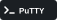

## Technologies & Tools

### Frontend
      

### Backend
  

### Tools
        

### Cloud
 

## 🔗 Let's Connect!

  

Welcome to my GitHub profile! This is a work in progress—more about me and my projects coming soon.
